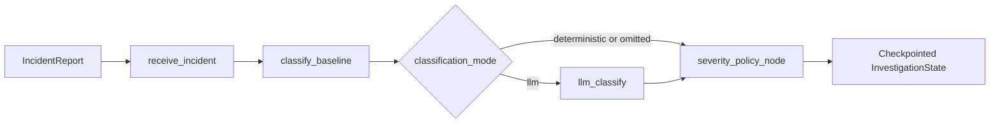

# Phase 2 classification implementation

This guide describes the code added for model-assisted classification of **synthetic** incidents. The default graph remains local and deterministic. The optional OpenAI route requires an explicitly injected model and `classification_mode = "llm"`. Neither route authorizes remediation.

## Data flow



The baseline runs first in both routes. A model can add a structured interpretation and replace the symptom list. The policy determines `final_severity` from report-supported impact. `recommended_severity` remains in `model_interpretation`; it is never copied directly into `final_severity`.

## State and contracts

| Field | Meaning |
| --- | --- |
| `incident` | Incoming `id`, `service`, and `summary`; these facts are not rewritten by classification nodes. |
| `severity` | Initial baseline severity, or the same baseline result after fallback. |
| `symptoms` | Baseline symptom list, or validated model symptoms after a successful model call. |
| `model_interpretation` | Validated `classifySchema` output, or `None` after fallback. No raw provider object is stored. |
| `classification_source` | `baseline`, `llm`, or `baseline_fallback`. |
| `failure_reason` | `None` on success, otherwise `invalid_output`, `timeout`, `provider_unavailable`, `rate_limited`, or `provider_error`. |
| `final_severity` | Deterministic policy result; this is the value to report as the final classification. |
| `severity_policy_reason` | Explains whether policy used baseline impact, grounded impact, or stayed uncertain. |

`classifySchema` in `schemas.py` is the model's output contract. It requires a severity recommendation, known symptom names, rationale, affected components, reported impact, source references, and uncertainties. `confidence` is optional but must be between zero and one. The model prompt asks for exact contiguous quotes in `source_references` to ground impact claims. Runtime `TypeAdapter` validation enforces shape and types, while `severity_policy` checks whether quoted impact appears in the current report.

## Functions by file

### `python/src/sentinel/schemas.py`

| Contract or function | Role |
| --- | --- |
| `IncidentReport` | Minimal validated input: nonempty `id`, `service`, and `summary`. |
| `classifySchema` | Model response shape, separate from graph state. Its `recommended_severity` is advisory. |
| `InvestigationState` | Fields shared by graph nodes and stored in checkpoints. Optional fields allow nodes to return partial updates. |
| `validate_incident` | Rejects missing, blank, or nonstring input fields at the graph boundary. |

### `python/src/sentinel/graph.py`

| Function | Role |
| --- | --- |
| `receive_incident` | Validates the incident and initializes empty symptoms, hypotheses, and evidence plus `unknown` severity. |
| `classify_baseline` | Calls the Phase 1 rule classifier and records `classification_source = "baseline"`; clears prior model interpretation and failure reason. |
| `route_classification` | Reads `classification_mode` from LangGraph configuration. Omitted or `deterministic` goes directly to policy; `llm` enters the model node; any other value raises `ValueError`. |
| `severity_policy_node` | Passes the current report, baseline severity, and optional model interpretation to the deterministic policy. |
| `build_graph` | Compiles a new graph with an `InMemorySaver`. It accepts an injected model; requesting `llm` mode without one raises an explicit error. Each invocation needs a `thread_id`. |

### `python/src/sentinel/nodes/classify.py`

| Function | Role |
| --- | --- |
| `_matches` | Finds configured symptom or impact phrases and detects simple nearby negation. |
| `classify` | Returns only baseline `severity` and `symptoms`. It is reused on normal deterministic runs and model failure. It does not authorize action. |

### `python/src/sentinel/nodes/llm_classify.py`

| Function or type | Role |
| --- | --- |
| `ClassificationModel` | Small `invoke(description)` protocol; fake models and the OpenAI adapter implement it. |
| `TransientProviderError` | Signals temporary provider failures such as rate limiting. |
| `_failure_reason` | Converts timeout, connection, and transient exceptions into stable state reason values. |
| `invoke_with_retry` | Makes at most three calls by default for temporary failures, sleeping with exponential backoff between attempts. Other errors are not retried. |
| `_RetryingModel.invoke` | Wraps the injected model so both initial interpretation and schema repair use the bounded provider-call retry rule. |
| `interpret_incident` | Calls the model, validates with Pydantic, and makes one repair call if the response is invalid. The repair prompt includes the original incident, JSON schema, and validation errors. |
| `build_llm_classify_node` | Produces a LangGraph node. On success it stores validated interpretation and model symptoms. On invalid repair or provider failure it invokes the deterministic baseline and records `baseline_fallback` and a reason. |

The provider retry limit and the one schema-repair limit are separate. One incident can have more than three total provider attempts if the initial response is malformed and its repair call experiences temporary failures. Both limits remain finite.

### `python/src/sentinel/nodes/severity_policy.py`

| Function | Role |
| --- | --- |
| `_negated_scope` | Looks for a simple negation before a configured impact phrase, or an explicit statement that no users or customers are affected. |
| `_supported_scope` | Maps an exact quoted report span to one of `sev1`, `sev2`, or `sev3`, returning `unknown` for absent, negated, or mixed scope. |
| `severity_policy` | Keeps a known baseline result unless its scope is explicitly negated. If baseline impact is unknown, it requires exact report references and fixed scope mapping. Missing, unsupported, or conflicting claims remain `unknown`. It returns `final_severity` and `severity_policy_reason`. |

The scope and negation rules are intentionally small. They can miss paraphrases or complex contradictions; model confidence and recommendations never bypass them.

### `python/src/sentinel/openai_classifier.py`

| Function or type | Role |
| --- | --- |
| `CLASSIFICATION_SYSTEM_PROMPT` | Treats the incident as data, requires report-grounded impact quotes, forbids invented counts and metrics, and directs the model to state uncertainty. |
| `StructuredChatModel` | Protocol for the small part of LangChain used by the adapter, enabling fake-client tests. |
| `OpenAIClassificationModel.invoke` | Sends system and user messages, returns parsed structured data, or passes malformed raw content to `interpret_incident` for one repair attempt. It also accumulates provider-reported token usage. |
| `OpenAIClassificationModel.token_usage` | Returns reported input/output token totals and count of calls carrying usage metadata. Calls that fail before a response may have no usage record. |
| `_raise_translated` | Maps HTTP 429, temporary 5xx, SDK timeout, and SDK connection errors to the retry categories. Permanent errors propagate to immediate baseline fallback. |
| `create_openai_classifier` | Requires `OPENAI_API_KEY` and `SENTINEL_OPENAI_MODEL`, creates LangChain `ChatOpenAI` only when called, disables its internal retries, and binds a JSON Schema derived from `classifySchema`. It makes no API call during construction. |

### `python/evaluation/evaluate_classification.py`

| Function | Role |
| --- | --- |
| `load_env_file` | Loads only `OPENAI_API_KEY` and `SENTINEL_OPENAI_MODEL` from an explicitly supplied local file; it never prints their values. |
| `load_incidents` | Reads labeled JSONL records for evaluation. |
| `_score` | Computes severity accuracy, micro symptom precision/recall, mean and 95th-percentile latency, and mismatched IDs. `unknown` counts as a severity class. |
| `_usage` | Reads cumulative token totals from an adapter when available. |
| `evaluate_dataset` | Runs baseline and model graphs on separate checkpoint threads for each case. Only `id`, `service`, and `summary` reach the graph. It records valid structured-output rate, fallback rate, failure reasons, latency, and optional token-based cost estimates. |
| `main` | CLI entry point. Requires `--live` before any provider call, supports an explicit `--env-file`, dataset and output paths, and optional user-supplied token prices. |

`structured_output_validity_rate` means the fraction of cases that finish with a validated model interpretation, including successful repair. It is not the first-attempt validity rate. `estimated_cost_usd` uses reported tokens and the supplied rates; caching, regional pricing, retries without usage metadata, and provider billing adjustments can make the invoice differ.

## Running and checking

From `python/`, install the optional dependency with `python -m pip install -e '.[llm,dev]'`. The default graph works without it. Keep credentials in an ignored local `.env` or process environment; never commit them. To run the explicit model comparison on the frozen v1 set:

```sh
python evaluation/evaluate_classification.py --live --env-file ../.env \
  --dataset evaluation/incidents_v1.jsonl \
  --output evaluation/results_phase2_luna_v1.json \
  --input-usd-per-million 0.10 --output-usd-per-million 0.50
```

The price arguments are examples for the recorded Luna Standard run; check current provider prices before a later run. The script sends only synthetic incident summaries to the provider. To check local behavior without credentials, run `pytest -q tests`, `ruff check src tests evaluation`, and `ruff format --check src tests evaluation`.

See [evaluation/README.md](../python/evaluation/README.md) and [PHASE2_REVIEW.md](../python/evaluation/PHASE2_REVIEW.md) for dataset boundaries and measured results.
